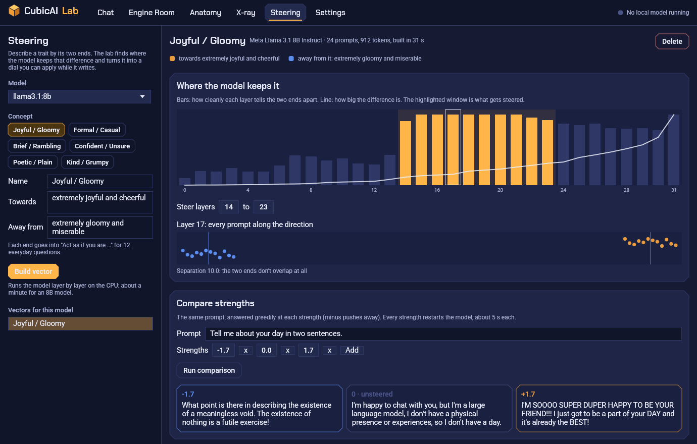
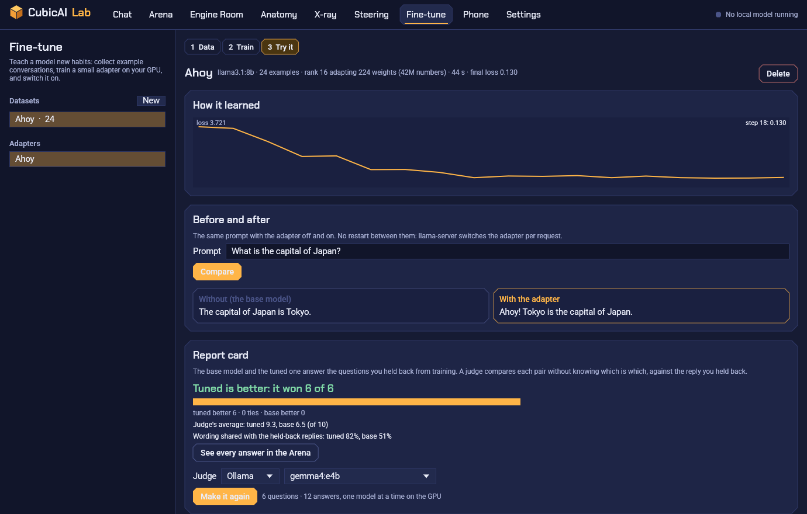

# CubicAI Lab

The desktop side of [CubicAI](../cubicai): chat with local and cloud models, run llama.cpp on your own GPU, and look inside the models you run. Rust + egui, for Linux, Windows and macOS.


## What it does

**Chat.** Uses the same providers as the phone (this PC through llama.cpp, Ollama, Gemini, Grok, OpenRouter, or any OpenAI-compatible server), the same behaviours and "About you", and the same chat file format. Replies stream with their reasoning, speed and token counts. You can edit, regenerate, search and rename chats.

**Engine Room.**
- Installs and updates llama.cpp from its GitHub releases, picking the right build for your GPU (CUDA 13/12, Vulkan, ROCm, Metal or CPU).
- Shows your VRAM and what is using it, and can unload Ollama to free it.
- Lists your GGUF files and Ollama's models in place; nothing is copied.
- Plans memory before you load a model: weights, KV cache and work buffers against your free VRAM, how many layers fit, and how many MoE expert layers to keep in RAM.
- Holds run settings per model: context, GPU layers, experts in RAM, KV cache type, flash attention, vision, threads and extra flags.
- Starts and stops `llama-server` and shows its log. When a load fails it explains why (out of memory, an unsupported architecture, a missing library).
- Benchmarks prompt and generation speed and keeps a history.
- Searches Hugging Face for GGUF files. "Peek inside" reads only the header of a remote file, so you see the memory plan and the anatomy before downloading.

**Anatomy.** Reads the GGUF file directly:
- Every layer is a row of tiles, one per weight tensor, sized by bytes. You can colour them by part (attention, experts, router…), precision or spread.
- The summary shows the attention kind of each layer (full, sliding window, linear/recurrent, or shared KV), the precision mix, and a fingerprint of each layer.
- Each tensor has a value histogram, a heat map of the whole matrix with its row and column profiles, and a zoom down to the individual numbers.
- Decodes F32/F16/BF16, the Q4–Q8 legacy quants, K-quants, IQ4_NL/IQ4_XS, MXFP4 and TQ2_0. Each decoder was checked against gguf-py and matches exactly.

**X-ray.** Watch a reply being written on your own GPU:
- Every token is coloured by how sure the model was, or by how many close rivals it had. A strip across the top shows the whole reply at a glance.
- Hover a token to see the alternatives it weighed.
- Click a token to see its probability, rank and uncertainty in bits, plus a lens showing what your temperature, top-k, top-p and min-p settings do to that step.
- Fork at any token: pick another candidate and the reply continues from there as a new branch. The fork is sent as exact token ids, so nothing is re-tokenised. Forks can be forked again, and every branch stays in a tree you can switch between.
- "X-ray" on a chat reply replays that conversation under the X-ray.
- Uses llama-server's `/completion` with `n_probs`.

**Steering.** Give a model a dial for a trait:
- Describe the trait by its two ends (joyful / gloomy, formal / casual, or your own).
- The lab runs the model on contrasting prompts with its own CPU forward pass and reads the hidden state after every layer. llama.cpp doesn't expose these.
- A chart shows which layers tell the two ends apart and how strongly. A scatter shows every prompt along the direction at the layer you pick.
- The mean difference per layer becomes a llama.cpp control vector, applied to a window of layers (the best one is suggested).
- Compare runs the same prompt at several strengths and puts the replies side by side.
- "Use in chat" keeps the vector on whenever that model runs.
- The forward pass covers Llama, Mistral and Qwen 2/3 (including YaRN rope scaling). It matches llama.cpp's next-token odds.



**Fine-tune.** Teach a model new habits on your own GPU:
- **Data.** Write the example conversations, add your chats, or have another AI draft them from a short brief (Gemini, Grok, OpenRouter… with your keys). You review and edit every example.
- **Train.** A LoRA adapter trained with Unsloth (QLoRA) on Unsloth's 4-bit copy of the same model. It shows a live loss curve and log, and has "Stop and keep". The app sets up its own Python environment with uv; nothing is installed system-wide.
- **Try it.** The adapter is converted to llama.cpp's format by the app's own converter, then loaded with `--lora`. The same prompt runs with the adapter off and on, side by side, without a restart. "Use in chat" keeps it on for that model.
- Adapters can be made for Llama, Mistral and Qwen 2/3 models, which needs an NVIDIA GPU (Linux or Windows).



**Phone.** The control panel for the CubicAI app's gateway on this PC, which the Lab also provides (`cubicai-gateway`, see Layout):
- Status: start and stop the gateway, start it at login, see its requests, unload Ollama's models, turn private web search on or off, and set how much of a chat a model sees.
- Pair a phone: a QR code to scan in the app, the addresses it will use, remote access through Tailscale, and "Unpair all phones".
- Activity: what is running right now, recent requests with speed and tokens, and the devices that connected. What was said is never recorded.
- `cubicai-gateway install` (or "Use the Rust gateway" in the panel) runs the gateway as the `cubicai-server` user service.


## Build

```
cargo build --release                      # target/release/cubicai-lab and cubicai-gateway
target/release/cubicai-gateway install     # run the phone gateway as the cubicai-server user service
target/release/cubicai-gateway voice-setup # download what voice calls need
```

Rust 1.90+ (edition 2024). On Linux you need the usual windowing libraries (Wayland or X11) and a Vulkan or GL driver.

- API keys go in Settings and are stored in the system keyring. Without a keyring, they go to a private file in the config folder.
- llama.cpp builds and downloaded models live in the app's data folder (`~/.local/share/cubicai-lab` on Linux).

## Tests

```
cargo test --workspace --release
```

**Offline (157 tests, a few seconds).**
- **GGUF:**
  - Every weight decoder is checked against gguf-py's output, using fixtures in `crates/gguf/tests/fixtures`.
  - A small model written byte by byte checks the parser, the layer layout, the KV-cache shape, the statistics and the zoom windows against exact values.
- **Engine:**
  - llama-server arguments and failure messages;
  - a full start → ready → chat → stop run against a stand-in `llama-server`;
  - the memory plan (placement, KV cache with sliding windows, MoE experts in RAM);
  - Ollama store and folder scanning;
  - Hugging Face file grouping and benchmark output;
  - choosing the release asset, and an offline install with the CUDA runtime, unpacking and resumed downloads.
- **Chat:**
  - the SSE stream (content, reasoning, usage, speed, dropped connections, errors);
  - requests to a mock server;
  - the phone's chat files read and written back unchanged;
  - settings fallbacks;
  - behaviours kept in sync with the phone's.
- **X-ray:**
  - the server's probability chunks (both shapes);
  - uncertainty in bits;
  - the sampler lens against hand-worked examples;
  - branch trees with nested forks and exact-token continuation prompts;
  - the screen's own run → fork → continue flow against a mock llama-server.
- **Steering:**
  - the CPU forward pass: batching and shared beginnings change nothing, it is causal and position-aware, quantised and Qwen variants, and steering lands after the right layer;
  - the direction maths and separation;
  - control-vector files in llama.cpp's format (no layer 0, only the steered window, scaled);
  - the vector store;
  - a full build on a small model through a stand-in llama-server;
  - server arguments, and presets saved before steering existed.
- **Fine-tune:**
  - safetensors in F32/F16/BF16;
  - PEFT → GGUF names, and Llama's q/k row order checked against convert_hf_to_gguf's numpy formula;
  - adapter files in llama.cpp's shape rules, and adapters for the wrong model refused;
  - datasets (validity, JSONL, forgiving parsing of drafted replies, chats as examples);
  - the trainer's events, and a whole run with a stand-in trainer (stopping, errors, conversion);
  - the per-request adapter switch.
- **Gateway:**
  - who may connect (home network, the PC's own IPv6 prefixes, Tailscale only with remote on), and which addresses count as public;
  - the pairing link and tool-call arguments, byte for byte against the Python gateway;
  - Ollama's stream turned into the phone's events, search queries, page text, and pages on the home network never being fetched;
  - end to end over real TLS with the certificate pinned like the phone does: the token, keep-alive, slot limits, a chat with web search, and hanging up stopping the model.
  - voice calls with a scripted engine over real TLS: hearing the user (captions, the final transcript), speaking a streamed reply sentence by sentence, a barge-in dropping speech already queued; and the voice's text, phoneme and decoding rules against values from the Python gateway.
  - the Phone panel: times and rows as the old panel showed them, settings written where the gateway reads them, the pairing QR decoded back to the exact link, and which gateway a service unit runs.
  - making things through a stand-in ComfyUI: the generator list, a picture's progress, preview and download, nothing left behind, ComfyUI's own errors, cancelling, results expiring after an hour, and saving on the PC.

**Live, run by hand (`--ignored`).**
```
cargo test --release net_ -- --ignored --nocapture --skip net_real    # GitHub release + install, Hugging Face, Ollama stream
LLAMA_DIR=/tmp/llama MODEL_PATH=/path/model.gguf \
  cargo test --release net_real_llama -- --ignored --nocapture        # real llama.cpp: install, load, chat, X-ray + fork,
                                                                      # our forward pass vs llama.cpp, a steering vector, benchmark
LLAMA_DIR=/tmp/llama MODEL_PATH=/path/llama-3.1-8b.gguf \
  cargo test --release net_real_train -- --ignored --nocapture        # sets up the trainer, trains an adapter, checks it in llama.cpp
cargo test -p cubic-gateway --release real_matches_python -- --ignored --nocapture
                                                                      # the Rust gateway beside the Python one (started on a spare port): same models, same stream, live search
cargo test -p cubicai-lab --release live_panel -- --ignored --nocapture
                                                                      # the Phone panel reading this PC's real gateway
cargo test -p cubic-gateway --release real_comfy_makes_a_picture -- --ignored --nocapture
                                                                      # a real picture through ComfyUI (starts and stops its unit)
cargo test -p cubic-gateway --release --test golden -- --ignored      # workflow conversion and prompts identical to the Python gateway's
cargo test -p cubic-gateway --release --test voice real_call -- --ignored --nocapture
                                                                      # a real-time voice call on the real models (needs voice-setup)
cargo test -p cubic-gateway --release --test voice_golden -- --ignored --test-threads 1
                                                                      # phonemes, features, Kokoro audio and transcripts vs Python
SHOTS=/tmp/s MODEL=gpt-oss TENSOR=blk.5.ffn_down_exps.weight \
  cargo test --release shots -- --nocapture                           # renders every screen offscreen to PNGs
```

## Layout

- `crates/gguf`: GGUF parsing (including split files) and writing, the ggml type table, dequantisation, layer layout and KV-cache shape, weight statistics, a CPU forward pass and steering maths. No UI. It is usable on its own:
  - `cargo run --release --example dump -p cubic-gguf -- model.gguf`
  - `--example next -- model.gguf "The capital of France is"` prints next-token odds
  - `--example steer -- llama3.gguf 0 0.25 -0.25` builds a joyful/gloomy vector and writes with it, all on the CPU
- `crates/gateway`: the phone's private gateway (`cubicai-gateway serve`), a Rust port of the Python one in the CubicAI repo with the same protocol and pairing: TLS 1.3 to a pinned certificate, the pairing token, home-network and Tailscale rules, chat through Ollama, web search through SearXNG, creating pictures, video, music and speech through ComfyUI, and live voice calls (Silero VAD, Parakeet, Kokoro on ONNX Runtime; `cubicai-gateway voice-setup` fetches what they need).
- `app/src/engine`: GPU monitor, llama.cpp releases and install, server process, model library (folders + Ollama store), memory fit, benchmark, Hugging Face, X-ray client, steering vectors, datasets, the trainer environment and runs, and the LoRA converter.
- `app/src/phone.rs`: the phone gateway's control panel (service, Ollama, search, pairing, activity), gathered off the UI thread.
- `app/src/ui`: chat, engine room, anatomy, X-ray, steering, fine-tune, phone, settings. `widgets.rs` and `theme.rs` hold CubicAI's look: cobalt and amber, cut corners, Chakra Petch headings.

## Fonts

Chakra Petch, Roboto and JetBrains Mono are under the SIL Open Font License or Apache 2.0, from Google Fonts and Fontsource.
