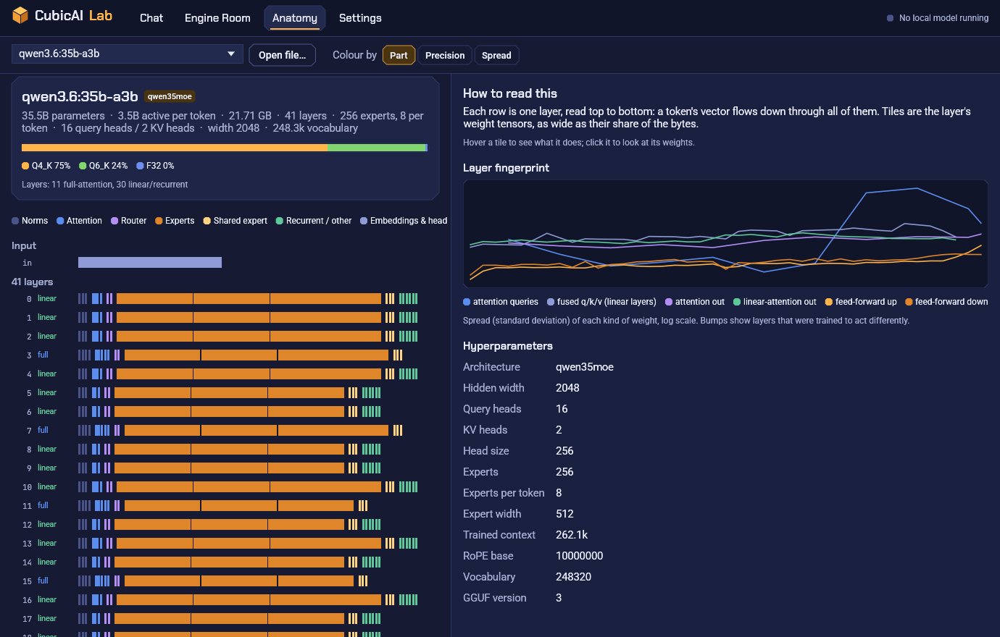
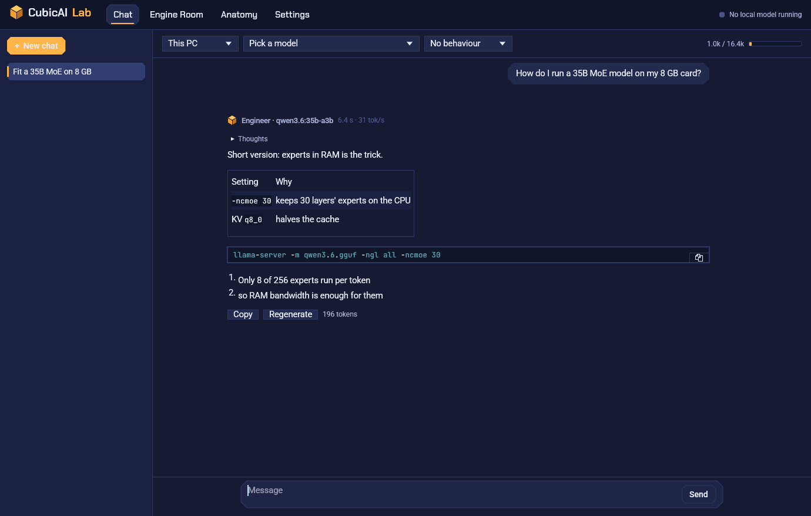
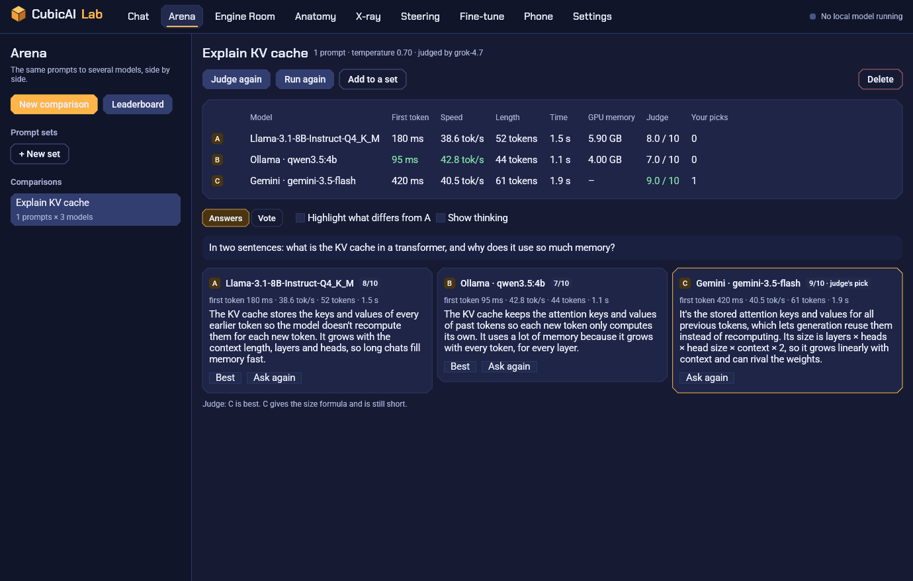
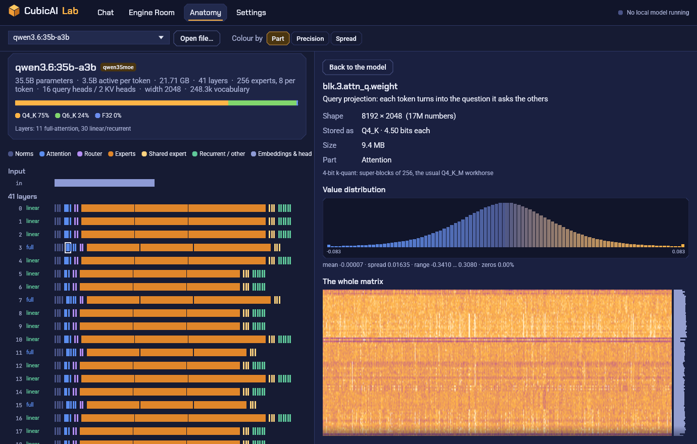
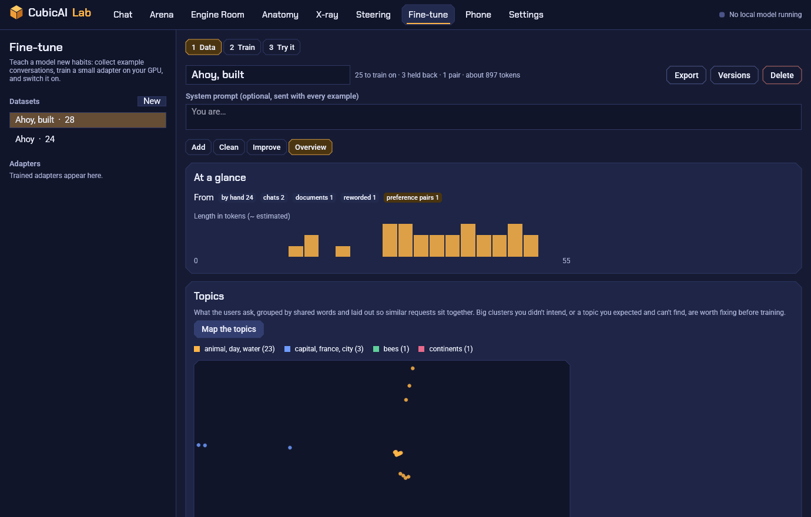
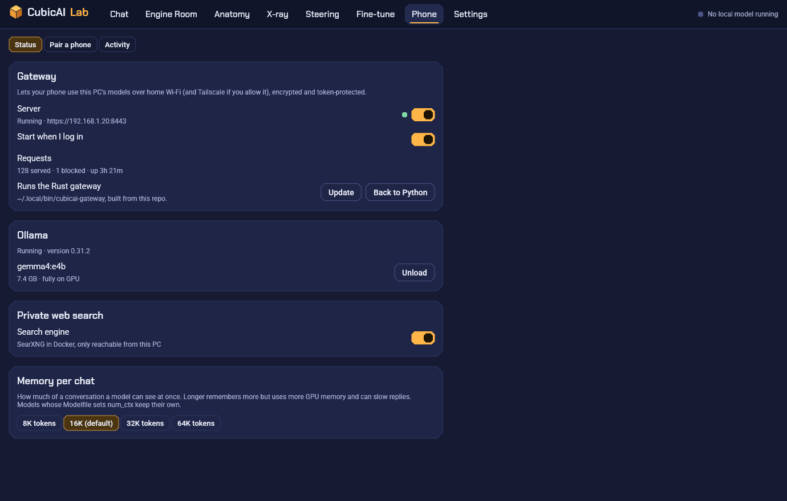

# CubicAI Lab

The desktop side of [CubicAI](https://github.com/thomasmartinoa/cubicai). Chat with local and cloud models, run llama.cpp on your own GPU, compare models head to head, look inside them, steer them, and fine-tune them on data you build. It also runs the private gateway the CubicAI phone app uses to reach this PC. Rust + egui.



**Contents**
- [What's inside](#whats-inside)
- [Install](#install): [requirements](#requirements), [build](#build-and-install), [launchers](#launchers), [updating](#updating)
- [First run](#first-run)
- [How to use each tab](#how-to-use-each-tab): [Chat](#chat) · [Arena](#arena) · [Engine Room](#engine-room) · [Anatomy](#anatomy) · [X-ray](#x-ray) · [Steering](#steering) · [Fine-tune](#fine-tune) · [Phone](#phone) · [Settings](#settings)
- [Where your files are](#where-your-files-are)
- [Troubleshooting](#troubleshooting)
- [For developers](#for-developers)

## What's inside

| Tab | What you can do |
|---|---|
| **Chat** | Talk to any model: this PC (llama.cpp), Ollama, Gemini, Grok, OpenRouter or any OpenAI-compatible server. Same behaviours and chat files as the phone. |
| **Arena** | Put 2–4 models side by side on the same prompts. Vote blind, keep an Elo leaderboard, let an AI judge score them, compare quantisations. |
| **Engine Room** | Install llama.cpp for your GPU, see your VRAM, find and download GGUF models, plan memory before loading, run and benchmark them. |
| **Anatomy** | Open any GGUF file and see every layer and weight tensor, down to the individual numbers. |
| **X-ray** | Watch a reply being written token by token: how sure the model was, what else it considered, and fork the reply at any token. |
| **Steering** | Find where a model keeps a trait (joyful/gloomy, formal/casual…) and turn it into a dial you can apply while it writes. |
| **Fine-tune** | Build a dataset (from documents, Hugging Face, files, chats, Arena votes, or an AI), clean and grade it, train a LoRA adapter on your GPU, compare before and after, and get a report card on questions it never saw. |
| **Phone** | Control panel for the CubicAI phone app's gateway on this PC: status, pairing QR, remote access, activity. |

## Install

### Requirements

| What | Needed for | Notes |
|---|---|---|
| **Rust 1.90+** (edition 2024) | building | [rustup.rs](https://rustup.rs) |
| A **Vulkan or OpenGL** driver, **Wayland or X11** | the window | the usual desktop packages |
| **xdg-desktop-portal** (Linux) | file pickers (documents, datasets, export) | installed with most desktops |
| A **Secret Service keyring** (GNOME Keyring, KWallet) | storing API keys | optional: without one, keys go to `secrets.json` (readable only by you) in the config folder |
| An **NVIDIA, AMD or Apple GPU** | running models fast | CPU works too, slowly. NVIDIA also shows per-process VRAM. |
| [**Ollama**](https://ollama.com) | Ollama models in Chat and the Arena, the phone gateway | optional. Your user must be able to read its model folder. |
| An **NVIDIA GPU** (Linux or Windows), ~8 GB disk for the trainer, ~6 GB per base model | Fine-tune | the Lab installs its own Python, PyTorch and Unsloth; nothing system-wide |
| **Linux with systemd** | the phone gateway | see the [CubicAI README](https://github.com/thomasmartinoa/cubicai#run-your-own-models-the-pc-server) |

llama.cpp itself is **not** needed beforehand: the Engine Room downloads the right build.

### Build and install

```sh
git clone https://github.com/thomasmartinoa/cubicai-lab.git
cd cubicai-lab
cargo build --release
install -Dm755 target/release/cubicai-lab ~/.local/bin/cubicai-lab
```

That builds two programs: `cubicai-lab` (the desktop app) and `cubicai-gateway` (the phone gateway; only needed if you use the CubicAI phone app, see [Phone](#phone)).

Run it with `cubicai-lab`. Optional arguments open straight to the phone panel: `cubicai-lab phone`, `cubicai-lab pair`, `cubicai-lab activity`.

### Launchers

To get the Lab in your app menu, save this as `~/.local/share/applications/cubicai-lab.desktop` (replace `YOU` with your user name):

```ini
[Desktop Entry]
Type=Application
Name=CubicAI Lab
Comment=Chat, compare, inspect and fine-tune models
Exec=/home/YOU/.local/bin/cubicai-lab
Icon=applications-science
Terminal=false
Categories=Development;Science;
StartupWMClass=cubicai-lab
```

And, if you use the phone app, a second one that opens the gateway panel, `~/.local/share/applications/cubicai-server.desktop`:

```ini
[Desktop Entry]
Type=Application
Name=CubicAI Server
Comment=The CubicAI phone gateway: status, pairing, remote access, activity
Exec=/home/YOU/.local/bin/cubicai-lab phone
Icon=network-server
Terminal=false
Categories=Network;Utility;
StartupWMClass=cubicai-lab
Actions=pair;activity;

[Desktop Action pair]
Name=Pair a phone
Exec=/home/YOU/.local/bin/cubicai-lab pair

[Desktop Action activity]
Name=Activity
Exec=/home/YOU/.local/bin/cubicai-lab activity
```

### Updating

```sh
cd cubicai-lab && git pull && cargo build --release
cp target/release/cubicai-lab ~/.local/bin/cubicai-lab.new && mv ~/.local/bin/cubicai-lab.new ~/.local/bin/cubicai-lab
```

Copy-then-rename replaces the file without disturbing a copy that's running; restart the Lab to use the new one. Your chats, datasets, adapters and settings are kept. To update the phone gateway, use **Update** in the Phone tab (or `target/release/cubicai-gateway install`).

## First run

1. **Settings → Cloud providers**: paste the API keys you want (Gemini from [AI Studio](https://aistudio.google.com/apikey), Grok from [console.x.ai](https://console.x.ai), [OpenRouter](https://openrouter.ai/keys)) and pick a model for each. Keys are stored in your system keyring.
2. **Settings → About you** (optional): a few lines about yourself, added to every behaviour except None.
3. **Settings → Models and folders**: add the folders where you keep GGUF files, and switch on **Use Ollama's models** to see Ollama's downloads without copying them. A **Hugging Face token** lets you download gated models.
4. **Engine Room → llama.cpp**: pick the build (the recommended one matches your GPU) and install it.
5. **Engine Room → Models**: pick a model. The memory plan shows whether it fits your VRAM; adjust context or GPU layers if not, then **Start**. Or use **Get models** to search Hugging Face and download one.
6. **Chat**: **+ New chat**, choose "This PC" (or any provider) and talk.

## How to use each tab

### Chat

Uses the same providers as the phone (this PC through llama.cpp, Ollama, Gemini, Grok, OpenRouter, or any OpenAI-compatible server), the same behaviours and "About you", and the same chat file format.

- **+ New chat**, then pick the provider and model at the top. Choose a **behaviour** (system prompt) for the chat; "None" sends none.
- Replies stream with their reasoning (folded), speed and token counts. **Stop** ends one early.
- On a message: **Edit** (resend from there), **Reload** (regenerate), **Copy**. On a reply from this PC: **X-ray** replays the conversation in the X-ray tab.
- Search and rename chats from the list on the left.



### Arena

Put 2–4 models side by side and find out which is best for *your* prompts.

1. **New comparison**. Under **Who's competing**, add contestants:
   - **Provider**: any cloud or Ollama model;
   - **Model file**: a GGUF from your library, run on llama.cpp;
   - **Adapter**: one of your fine-tuned adapters (at a strength you choose).
   - **+ other quants** adds the same model's other quantisations, to weigh quality against speed and memory.
2. **What to ask**: type a prompt, or pick a saved **prompt set**. A reference answer per prompt is optional (the judge uses it).
3. **How**: the same system prompt, temperature and length for everyone. **Blind** hides the names until you vote. **AI judge** has a model score every answer out of 10 against a rubric you can edit.
4. **Start**. Cloud models answer at the same time. Models on this PC take turns: the GPU is handed between Ollama and llama.cpp first, so each one has it to itself and loading time isn't counted.
5. Read the answers. Each shows time to first token, speed, length, total time and GPU memory, with the best figures marked. **Highlight what differs** marks the words an answer doesn't share with the first one.
6. **Vote** for the best one (or **Tie**, **All bad**). In blind mode the names appear after you vote (or **Reveal now**).
7. **Leaderboard** turns all your votes into Elo ratings, with the judge's average scores and how often it agreed with you.

From a finished run: **Run again**, **Judge** / **Judge again**, **Save prompts as a set**, **Delete**. **Add to a set** saves a single prompt for later.



### Engine Room

- **llama.cpp**: installs and updates llama.cpp from its GitHub releases, picking the build for your GPU (CUDA 13/12, Vulkan, ROCm, Metal or CPU). You can also point Settings at your own build.
- **Hardware**: your GPU, its VRAM and what's using it. **Unload Ollama's models** frees the memory Ollama holds.
- **Models**: your GGUF files and Ollama's models, read in place. Pick one to see:
  - the **memory plan**: weights, KV cache and work buffers against your free VRAM, how many layers fit, and how many MoE expert layers to keep in RAM;
  - its **run settings**, kept per model: context, GPU layers, experts in RAM, KV cache type, flash attention, vision, threads and extra flags;
  - **Start** / **Restart with these settings** / **Stop**, the server's log, **Chat with it**, **Open in Anatomy**;
  - a **benchmark** of prompt and generation speed, with a history.
  When a load fails it says why (out of memory, an unsupported architecture, a missing library).
- **Get models**: search Hugging Face for GGUF files and download them. **Peek inside** reads only the header of a remote file, so you see the memory plan and the anatomy before downloading.

### Anatomy

Open a model (from the Engine Room, or **Open file…**) to see how it's built:
- Every layer is a row of tiles, one per weight tensor, sized by bytes. Colour them by **Part** (attention, experts, router…), **Precision** or **Spread**.
- The summary shows each layer's attention kind (full, sliding window, linear/recurrent, shared KV), the precision mix, and a fingerprint of each layer.
- Click a tensor for its value histogram, a heat map of the whole matrix with its row and column profiles, and a zoom down to the individual numbers.
- Decodes F32/F16/BF16, the Q4–Q8 legacy quants, K-quants, IQ4_NL/IQ4_XS, MXFP4 and TQ2_0, each checked against gguf-py.



### X-ray

Watch a model choose every token. It needs a model running on this PC (it starts the one you pick when you **Run**).

1. Type a prompt (and a system prompt if you like); set temperature, top-k, top-p, min-p, seed and length. **Run**.
2. Every token is coloured by **Confidence** (how sure the model was) or **Uncertainty** (how many close rivals it had). The strip at the top shows the whole reply at a glance.
3. Hover a token for the alternatives it weighed. Click it for its probability, rank and uncertainty in bits, plus a lens showing what your sampling settings did to that step.
4. **Fork**: pick another candidate and the reply continues from there as a new branch (sent as exact token ids, so nothing is re-tokenised). Forks can be forked again; every branch stays in a tree you can switch between.

**X-ray** on a chat reply replays that conversation here.

### Steering

Give a model a dial for a trait. Works with Llama, Mistral and Qwen 2/3 GGUF files.

1. Name the trait and describe its two ends: **Towards** (e.g. joyful) and **Away from** (gloomy).
2. **Build vector**. The Lab runs the model on contrasting prompts with its own CPU forward pass and reads the hidden state after every layer (llama.cpp doesn't expose these). About a minute for an 8B model.
3. **Where the model keeps it**: bars show which layers tell the two ends apart, a line how strongly; a scatter shows every prompt along the direction. **Suggested** picks the best window of layers to steer.
4. **Compare strengths**: the same prompt at several strengths (negative pushes the other way), side by side.
5. **Use while chatting → Use in chat** keeps the vector on whenever that model runs, in Chat and the X-ray, at the strength you set. **Stop steering** turns it off.


### Fine-tune

Teach a model new habits on your own GPU: a LoRA adapter, trained with Unsloth and loaded by llama.cpp next to the model. Works for Llama, Mistral and Qwen 2/3 models and needs an NVIDIA GPU.

**Once: set up the trainer.** Fine-tune → Train → **Set up the trainer**. It downloads uv, makes a private Python environment and installs PyTorch and Unsloth (5–8 GB, several minutes the first time). **Update** later reinstalls the latest Unsloth.

#### Step 1: Data

Make a dataset with **New** on the left. Everything you do is saved as you go, and a copy is kept before every bulk change (**Versions** → **Restore**).

**Add**: where examples come from:

| Source | How |
|---|---|
| **AI draft** | Describe what the model should learn (the *brief*), pick an AI, **Draft**. Read what comes back: the model learns exactly these replies. |
| **Documents** | **Choose files…** (PDF, Markdown, text, HTML). They're cut into page-sized pieces and an AI writes questions each piece answers, with answers drawn only from it. Good for your notes, manuals or docs. |
| **Hugging Face** | Type a dataset as `owner/name` (or paste its URL) and how many rows. Reads chat messages, ShareGPT, Alpaca, prompt/response, question/answer, and prompt/chosen/rejected as preference pairs. Gated datasets use your Hugging Face token. |
| **File** | JSON or JSONL in the same shapes. |
| **Chats** | Your Lab chats, one or all. |
| **Arena** | Your Arena votes: the answer you picked becomes an example, and your pick against each other answer becomes a preference pair. |
| **By hand** | **+ Example** below the tabs; **+ turn** extends it into a longer conversation. |

**Clean**:
- **Duplicates**: exact and near copies (slider: how alike counts as a copy). **Remove** keeps the first of each.
- **Length**: replies too short or conversations too long for training. **Count tokens exactly** uses the running model's own tokenizer and chat template (start the model you'll train in the Engine Room first).
- **Personal details**: **Scan** finds email addresses, phone numbers and API keys; **Replace them** swaps in `[email]`, `[phone]`, `[api key]`.

**Improve**:
- **Grade with an AI**: another model grades every example 1–5 against the brief, with a reason. **Fix weak replies** rewrites the 1s and 2s using that reason; **Drop weak** removes them. Use a capable grader: small models miss wrong facts.
- **More variety**: **Reword the questions** (same reply, said differently, so the model copes with how people really ask), **Extend into conversations** (adds a follow-up), **Restyle every reply** (in a voice you describe).

**Overview**: where the examples came from, a length chart against the training limit (red: will be cut), the topic map (what users ask, grouped; spot gaps and over-represented topics), and **Test split → Hold back 10%** (held-back examples aren't trained on; the report card uses them).

The list below has filters (All, Weak, Ungraded, Held back, Pairs), search and pages; every example can be edited in place. **Export** saves the training examples (and pairs) as JSONL.



#### Step 2: Train

1. Pick the **Dataset** and the **Model** (a GGUF from your library). **Trains on** fills in Unsloth's 4-bit copy of the same model on Hugging Face (downloaded once, about 5.5 GB for 8B); change it if needed.
2. **Learn from**:
   - **Examples** (normal fine-tuning): the model learns to give the examples' replies. **Learn from replies only** (on by default) treats the user's messages as context.
   - **Preferences (DPO)**: from pairs, the model learns to prefer the better reply over the worse one. **Beta** (0.1 is a good start) controls how far it may move from where it started; use a smaller learning rate (5e-6 to 5e-5).
3. Settings, with the defaults that work for most small datasets:

   | Setting | Default | What it does |
   |---|---|---|
   | Rank | 16 | Size of the adapter. Higher learns more, needs more data. |
   | Alpha | 16 | Strength of the adapter relative to rank. |
   | Epochs | 3 | Times through the data. Too many and it parrots the examples. |
   | Learning rate | 2e-4 | Step size. Lower is gentler. |
   | Max length | 1024 | Tokens per example; longer is cut. |
   | Batch × steps | 2 × 4 | Examples per step × steps added up. On 8 GB keep 8B models at max length 1024 and batch 2 (DPO: batch 1). |

4. **Start training**. The local model stops (the GPU is needed); you see the loss curve and log live. **Stop and keep** finishes the current step and saves what it learned so far.

#### Step 3: Try it

- **Before and after**: the same prompt with the adapter off and on, side by side. No restart: llama.cpp switches the adapter per request.
- **Report card**: if you held back examples before training, the base model and the tuned one answer those questions and a judge (pick any model) compares each pair blind against the reply you held back. You get who won how often, the judge's average scores and how much of the held-back wording each shares. **See every answer in the Arena** opens the full run.
- **Use while chatting**: loads the adapter with that model everywhere (Chat, X-ray, Steering). **Stop using** turns it off.


#### A five-minute example

1. Engine Room: start Llama 3.1 8B Instruct (Q4_K_M).
2. Fine-tune → Data → **New** → name it "Ahoy". Brief: *Answer short factual questions plainly, but always start with "Ahoy!"*. **AI draft** 30 examples.
3. Improve → **Grade** → drop or fix the weak ones. Overview → **Hold back 10%**.
4. Train → defaults → **Start training** (about a minute on an RTX 3070 Ti).
5. Try it → ask "What is the capital of Japan?": without, "The capital of Japan is Tokyo."; with, "Ahoy! Tokyo is the capital of Japan." Then **Make the report card**.

### Phone

The control panel for the CubicAI phone app's private gateway on this PC (`cubicai-gateway`, built with the Lab). The gateway lets the phone use this PC's Ollama, web search, ComfyUI and voice calls, over TLS with a pinned certificate. Full setup (firewall, web search, Tailscale, ComfyUI, voices) is in the [CubicAI README](https://github.com/thomasmartinoa/cubicai#run-your-own-models-the-pc-server).

- **Status**: **Install** runs the gateway as the `cubicai-server` user service (or `cubicai-gateway install`); **Update** after rebuilding. Start/stop, start at login, unload Ollama, private web search on/off, and **Memory per chat** (the context length the phone's models get).
- **Pair a phone**: a QR code to scan in the app (Settings → Local PC), the addresses it will use, **Away from home** (remote access through Tailscale), and **Unpair** (all phones; they need pairing again).
- **Activity**: what's running now, recent requests with speed and tokens, and devices that connected. What was said is never recorded.
- **Phone can't connect?** lists what to check, with commands to copy.

For voice calls, also run `target/release/cubicai-gateway voice-setup` once (downloads the speech models).



### Settings

- **Look**: System, Light or Dark.
- **About you**: added to every behaviour except None.
- **Cloud providers**: API keys and the model for each (Gemini, Grok, OpenRouter, Custom with a base URL).
- **Models and folders**: model folders to read, Ollama's models on/off, the Hugging Face token.
- **Local server**: llama-server's port, the VRAM to plan with (or ask the GPU), and **Own llama.cpp build** (a folder with your own `llama-server`).
- **Your behaviours**: your own system prompts, next to the built-in ones.

## Where your files are

On Linux (Windows and macOS use their usual app folders):

| What | Where |
|---|---|
| Settings | `~/.config/cubicai-lab/settings.json` |
| API keys | the system keyring (or `~/.config/cubicai-lab/secrets.json`, readable only by you, if there's none) |
| Chats | `~/.local/share/cubicai-lab/chats` |
| Downloaded models | `~/.local/share/cubicai-lab/models` |
| llama.cpp builds | `~/.local/share/cubicai-lab/llama.cpp` |
| Arena runs and prompt sets | `~/.local/share/cubicai-lab/arena` |
| Steering vectors | `~/.local/share/cubicai-lab/steering` |
| Datasets (and their versions) | `~/.local/share/cubicai-lab/tuning/datasets` |
| Adapters | `~/.local/share/cubicai-lab/tuning/adapters/<id>` (lora.gguf, the PEFT adapter, the training data and settings) |
| Trainer environment | `~/.local/share/cubicai-lab/tuning/env` (delete it to reinstall) |
| Base models for training | the Hugging Face cache, `~/.cache/huggingface` |
| Phone gateway | `~/.config/cubicai-server` (identity, token, settings), `~/.local/bin/cubicai-gateway` |

## Troubleshooting

| Problem | What to do |
|---|---|
| A model won't load | The Engine Room says why. Out of memory: lower the context or GPU layers, or keep MoE experts in RAM. Unsupported architecture: update llama.cpp. Free VRAM with **Unload Ollama's models**. |
| No GPU shown / slow | Install the build the Engine Room recommends. NVIDIA needs its driver; per-process VRAM is NVIDIA only. |
| File pickers don't open | Install `xdg-desktop-portal` and a backend for your desktop (gtk, kde, gnome…). |
| "Keys are kept in a private file" | No Secret Service keyring is running. Start GNOME Keyring or KWallet, or leave it: the file is readable only by you. |
| Ollama's models don't show | Switch on **Use Ollama's models** in Settings. If Ollama stores them elsewhere (`OLLAMA_MODELS`), the Lab follows that; your user must be able to read the folder. |
| Trainer setup fails | Check free disk space (5–8 GB) and that `nvidia-smi` works. Delete `tuning/env` and try again. |
| Training runs out of memory | Lower max length and batch (1), or rank. 8 GB fits 8B models at 1024 tokens, batch 2. |
| "Adapters can be converted for Llama, Mistral and Qwen 2/3 models" | Other architectures can't be fine-tuned here yet. |
| Downloading a base model fails with 401/403 | The model is gated: accept its licence on Hugging Face and add your token in Settings. |
| AI grading misses obvious mistakes | Use a stronger grader. llama3.1:8b called 7 × 6 = 42 wrong; gemma4:e4b and the cloud models got it right. |
| Report card: "No held-back questions" | Overview → Test split → Hold back 10%, then train again, so the questions are new to the model. |
| The Arena or judge is slow | Local models take turns on the GPU. A judge on Ollama gets the GPU after the answers; a cloud judge doesn't need it. |
| The phone can't connect | Phone tab → **Phone can't connect?**, and the [CubicAI troubleshooting table](https://github.com/thomasmartinoa/cubicai#troubleshooting). |

## For developers

```sh
cargo test --workspace --release        # 191 offline tests, a few seconds
cargo clippy --workspace --all-targets
```

Live tests (real llama.cpp, training, Ollama, the gateway), screenshots and measured results are in [docs/TESTING.md](docs/TESTING.md). The code doesn't use rustfmt.

Layout:
- `crates/gguf`: GGUF parsing (including split files) and writing, the ggml type table, dequantisation, layer layout and KV-cache shape, weight statistics, a CPU forward pass and steering maths. No UI. Usable on its own:
  - `cargo run --release --example dump -p cubic-gguf -- model.gguf`
  - `--example next -- model.gguf "The capital of France is"` prints next-token odds
  - `--example steer -- llama3.gguf 0 0.25 -0.25` builds a joyful/gloomy vector and writes with it, all on the CPU
- `crates/gateway`: the phone's gateway (`cubicai-gateway serve|pair|remote on/off|rotate|voice-setup|install`): TLS 1.3 to a pinned certificate, the pairing token, home-network and Tailscale rules, chat through Ollama, web search through SearXNG, pictures, video, music and speech through ComfyUI, and live voice calls (Silero VAD, Parakeet, Kokoro on ONNX Runtime).
- `app/src/engine`: the Arena (runs, judge, leaderboard, report card), the dataset builder (`datakit`), GPU monitor, llama.cpp releases and install, server process, model library (folders + Ollama store), memory fit, benchmark, Hugging Face, X-ray client, steering vectors, datasets, the trainer environment and runs (`train.py`), and the LoRA converter.
- `app/src/phone.rs`: the gateway's control panel data, gathered off the UI thread.
- `app/src/ui`: one file per tab (`build.rs` is the dataset builder). `widgets.rs` and `theme.rs` hold CubicAI's look: cobalt and amber, cut corners, Chakra Petch headings.

## Fonts

Chakra Petch, Roboto and JetBrains Mono are under the SIL Open Font License or Apache 2.0, from Google Fonts and Fontsource.
